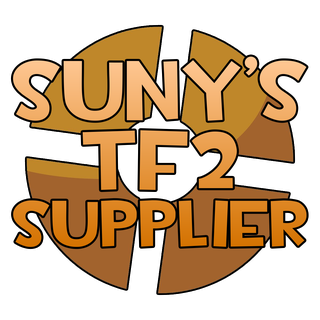
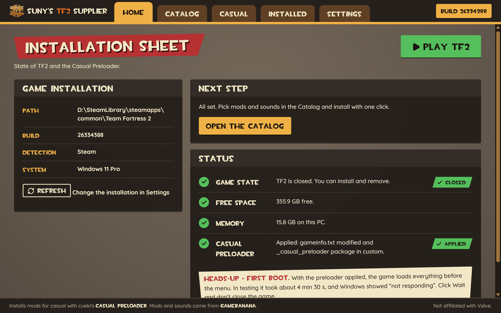
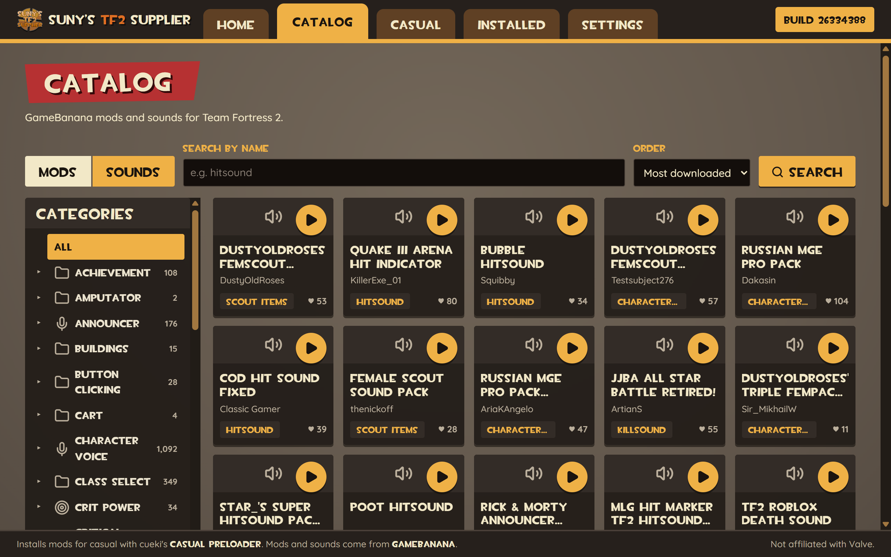
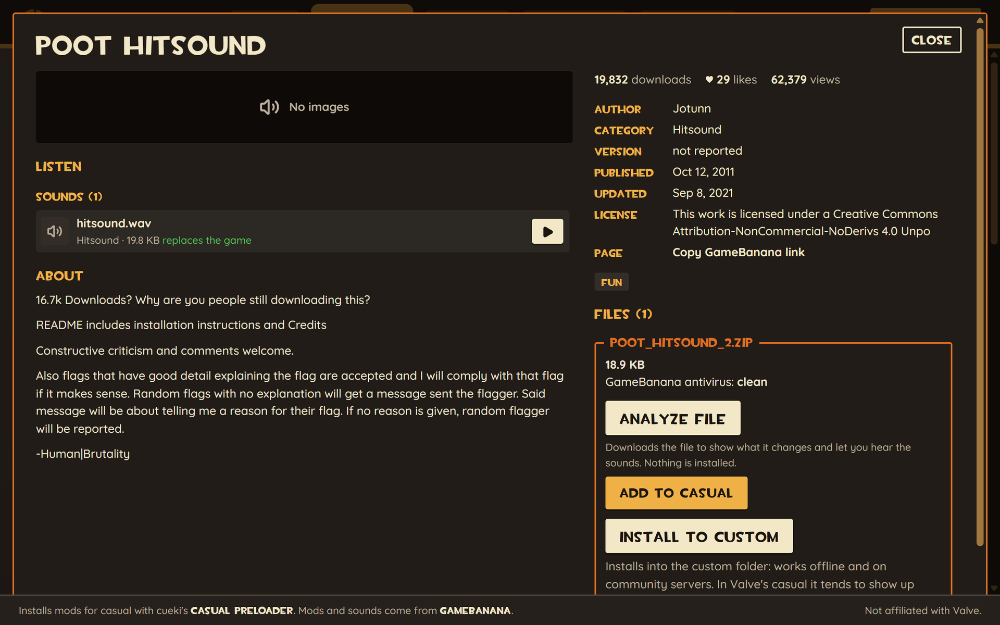
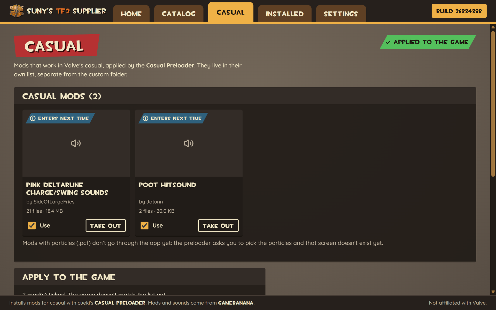
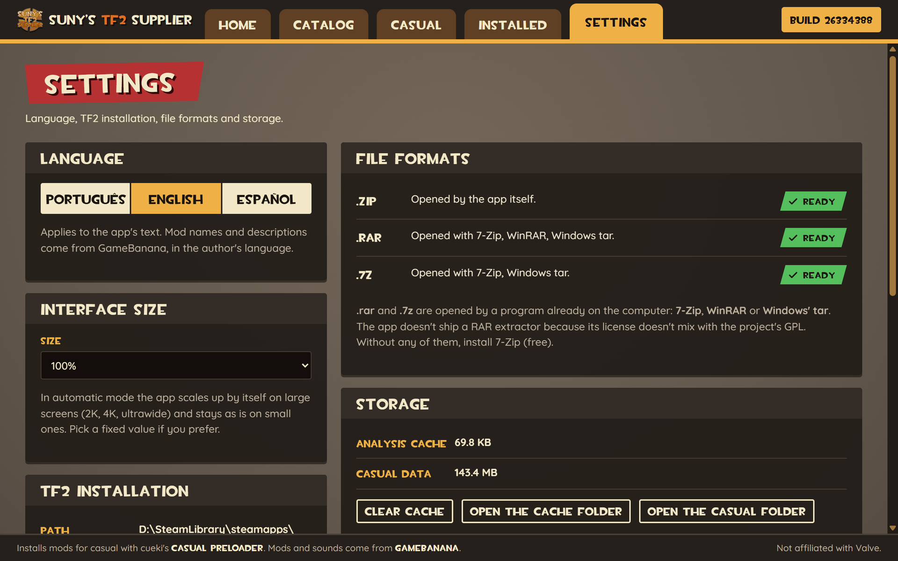

<p align="center">
  
</p>

DISCLAIMER, THE USAGE OF AI HAS BEEN USED IN THIS TOOL, WHY? CUZ I'M NOT SHERLOCK HOMES TO FIND ALL THE BUGS IN THIS DAMN APP DUDE. C'MON.


# Suny's TF2 Supplier (sTF2s)

this is just a passion project of mine, looking foward into making installing mods easier with a nice ui and a decent catalog using gamebanana API for it, this still a WIP because i need to test more stuff (or even make them faster if i found a proper way.) this mod loader/launcher/kittykat uses publci avaliable tools that are avaliable in the gamebanana websites.
erm, i guess that's it? why i need to add such a big text FOR A STRAIGHT FOWARD LAUNCHER??

also, the assets used ARE PURELY FROM THE GAME FOLDER.
im not a dumbass into putting or downloading copyrighted stuff from like steamgrid or something, using them locally is the best and easier way to use things.

also

there is a installer for the mod loader that has a updater innit, this app is fully open source and uh, yeah.
no viruses!!1!!1(((((((((((

imagine putting virus in a tf2 app, lowkey braindead.
and uh, yeah.

open source yippee!!!! have fun or something, i main demoknight so i dont have that much fun tho lol.


JUST ENJOY THE APP.

---

okay but for real, here's the stuff people actually ask:

## what it does

- **catalog**: mods and sounds straight from GameBanana, 5 columns, infinite scroll, categories, and a big page for each mod with all the screenshots, description, numbers and files.
- **install**: `.zip`, `.rar` and `.7z`. goes into `tf/custom`, in a folder the app owns, and it never touches stuff it didn't put there. only with TF2 closed.
- **analyze before installing**: shows what a mod changes (hitsound? demoman voice? weapons?), with the class icon, and you can **listen to the sounds** before you install anything.
- **casual**: uses [cueki's Casual Preloader](https://gamebanana.com/tools/19049) so mods work in Valve's casual. add mods to a list, hit apply, hit revert if you hate it. the preloader is downloaded from the official release (size + SHA-256 checked), it's not copied into this repo.
- **play button**: opens TF2 through Steam. greyed out while the game is open.
- **english, español, português**: change it in Settings.
- **updates**: the app checks the stable releases of this repo, tells you when a new one is out and shows the changelog. you decide when to update.

## screenshots

<p align="center">
  
  
  
  
  
</p>

(these were taken with the game's art turned off on purpose, so there's no Valve art in this repo. in the app you get the banner and class icons straight from your own TF2.)

## install it

grab the `...-setup.exe` from the [releases page](https://github.com/ArthurEnsolarado/suny-tf2-supplier/releases) and run it, it's a normal wizard (pt-BR, English, Español). no admin needed, it installs for your user.

windows might show a SmartScreen warning because the installer isn't code-signed yet. that's it, that's the "virus". you can check the SHA-256 in `SHA256SUMS.txt` next to the installer, or just build it yourself (below).

## about the updater

- it only looks at **stable** releases (no betas, no drafts) of this repo on GitHub.
- it never sends anything about you. it's one public request to GitHub's API.
- when you press update it downloads the installer, **checks the SHA-256** published with the release and only then opens it. no hash published = it refuses and sends you to the releases page.
- you can turn the check off in Settings.

## where the assets come from

- the TF2 banner, logo and the class icons are **read from your own Steam / TF2 install while the app runs**. nothing from Valve is in this repo or in the installer.
- mod images come from GameBanana's CDN and always show who made the mod.
- the in-game style font (TF2 Build) is **not included**, its license isn't clear. the app ships with [Lilita One](https://fonts.google.com/specimen/Lilita+One) instead (free license, looks close enough). if you own TF2 Build, drop `tf2build.ttf` in `app/public/fonts/` and it takes over on your machine.
- the app icon is mine.

## what it touches on your pc

| thing | where | when |
|---|---|---|
| mods you install | `tf/custom/<mod folder>` + `tf/custom/.suny/` (what was installed, so it can be removed cleanly) | install / remove, game closed |
| casual mods | the preloader changes `tf2_misc_*.vpk`, `gameinfo.txt` and `custom/_casual_preloader_*` | apply / revert, game closed. it keeps a copy of `gameinfo.txt` first |
| app data | `%LOCALAPPDATA%\suny-tf2-supplier\casual` (preloader, your casual list, backups) | casual setup |
| temp downloads | `%TEMP%\suny-tf2-supplier` | analyze / update. clear it in Settings |

after a TF2 update just apply again, the update undoes the mods (that's how the preloader works, not me).

## build it yourself

you need [Rust](https://rustup.rs) (1.94+), Node 20+ and Windows (the casual part needs the Windows preloader).

```powershell
npm --prefix app ci
cargo test -p suny-core            # the core has tests, run them
npm --prefix app run dev           # ui only, in the browser (also run the dev server below)
cargo run -p suny-core --example devserver
cd app; npx tauri build --bundles nsis   # makes the installer
```

the installer ends up in `target/release/bundle/nsis/` (or wherever your `CARGO_TARGET_DIR` points).

more details in [`docs/`](docs/) (they're in portuguese, sorry) and the credits are in [`CREDITS.md`](CREDITS.md).

## credits

- **cueki** for the [Casual Preloader](https://gamebanana.com/tools/19049) (GPL-3.0). this app is basically a nice face for it.
- **GameBanana** and every mod author, they're credited inside the app.
- Tauri, React, Vite and the Rust crates in `Cargo.toml`.

TF2 is a Valve trademark. this is not affiliated with Valve or GameBanana. league rules (like RGL) ban custom particles, check before you join a match.

license: GPL-3.0-or-later, see [`LICENSE`](LICENSE).
